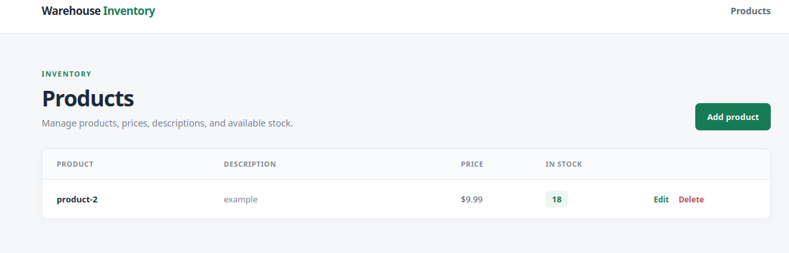

# Warehouse Inventory

A Flask web application for managing warehouse products, prices, descriptions, and stock amounts. Product data is stored in MySQL.



## Requirements

- Python 3.10 or newer
- MySQL 8.0 or newer for local development, or Docker with the Compose plugin

## Configure the environment

Copy `.env.example` to `.env` and set strong, unique values for `secretKey`, `dbRootPassword`, and `dbPassword`. The database variables use camelCase as shown in the example. The app refuses to start without a configured `secretKey` and either a `dbPassword` or `databaseUrl`. Keep `.env` private; it is ignored by Git.

The defaults for `dbHost` and `dbPort` target a local MySQL server. In Docker Compose, the app connects to the database service using the internal hostname `db`.

## Run locally

Start a MySQL server and create the `warehouse` database, then install and start the app:

```bash
python3 -m venv .venv
source .venv/bin/activate
pip install -r requirements.txt
cp .env.example .env
flask --app 'app:create_app()' run --debug
```

Set the database credentials in `.env` to match the local MySQL server. The app creates the `products` table on startup. Visit <http://127.0.0.1:5000>.

## Run tests

The tests use an isolated in-memory SQLite database and do not need a running MySQL server:

```bash
pytest
```

## Run with Docker Compose

Copy `.env.example` to `.env`, replace its placeholder credentials with strong values, then run:

```bash
docker compose -f compose.yml up --build
```

The app is available at <http://localhost:5000>. Compose builds the `appexample` image and starts MySQL with the `warehouse` database. The database data persists in the `warehouse_data` volume. To stop the containers, use `docker compose -f compose.yml down`; to remove persisted database data too, use `docker compose -f compose.yml down -v`.

## Security notes

- Database operations use SQLAlchemy's parameterized query layer rather than interpolating user input into SQL.
- Flask-WTF CSRF protection covers all state-changing forms, including product deletion. Jinja autoescapes displayed product data.
- Credentials and the Flask session signing key are read from environment variables and excluded from the Docker build context and Git. Use strong, private values in `.env`, and do not commit that file.
- The app container is only connected to MySQL over a private Compose network; only the web port is published to the host.
- Product names and numeric fields are validated server-side, and prices and stock amounts cannot be negative.
